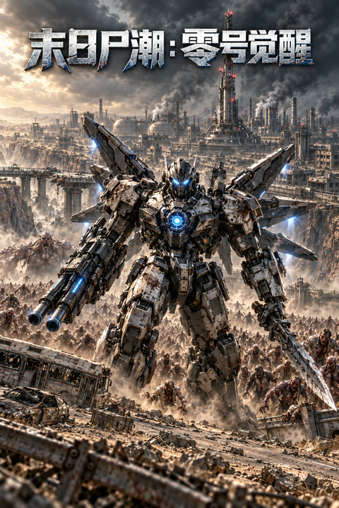
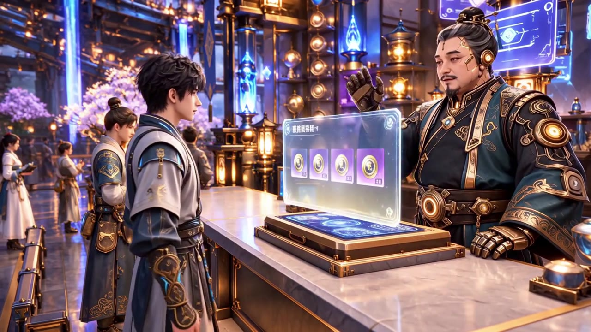
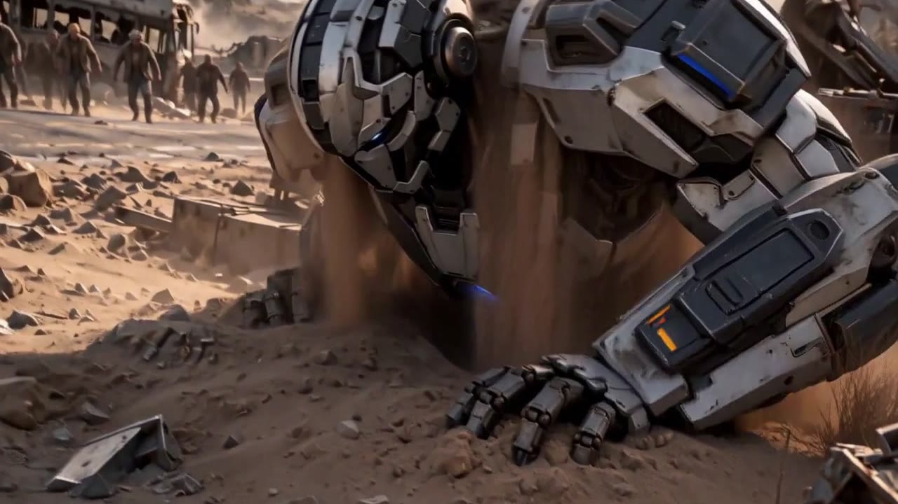
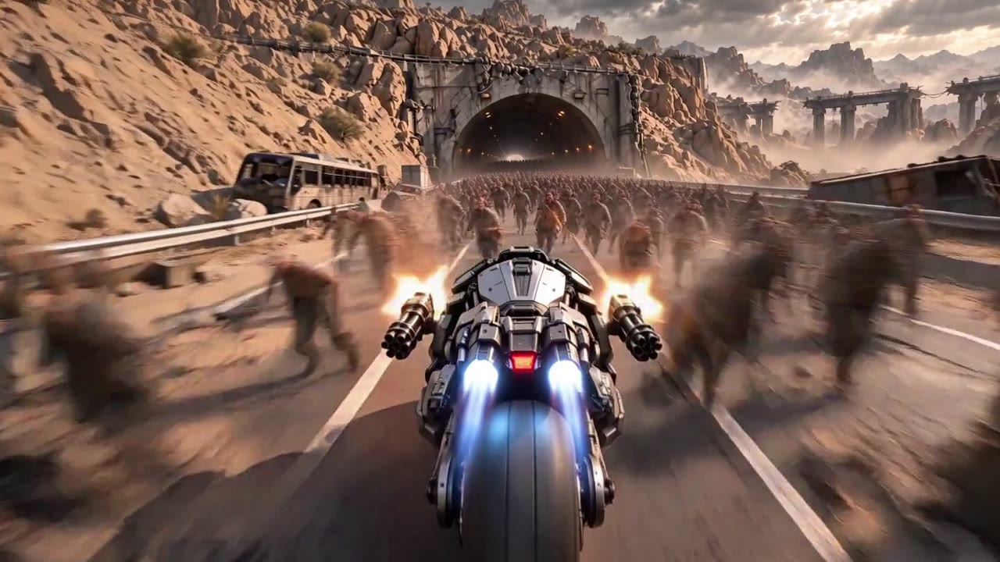
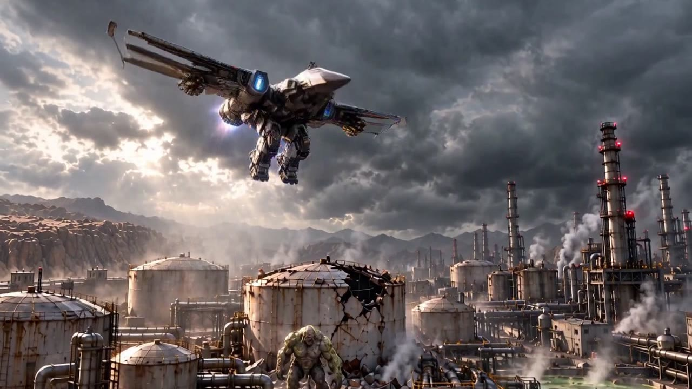
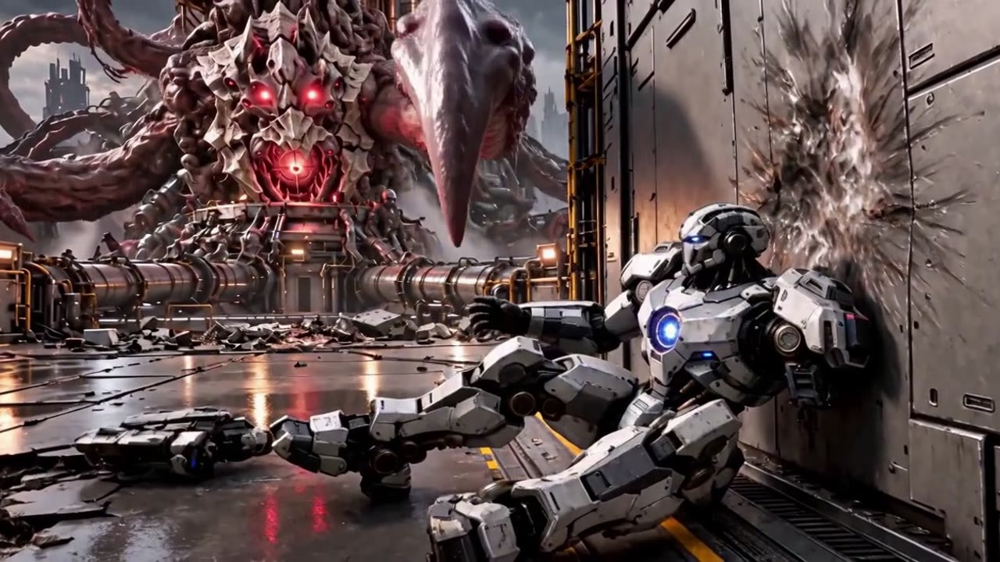
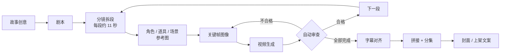

# 黑豆 AI 漫剧工作台 · 作品展示

> 一个人 + 一台 16GB 显卡的电脑，从一句故事创意到可上架的分集短剧。
> 本仓库只用于**展示项目成果和设计思路**，不包含源代码、提示词或任何配置文件。

  
  

---

## 项目简介

黑豆 AI 漫剧工作台是我独立设计并开发的一套**本地 AI 短剧生产系统**。它把短剧制作拆成「剧本 → 分镜 → 角色资产 → 场景 → 关键帧 → 视频片段 → 字幕 → 分集成片」的流水线，由一个本地网站统一调度：

- **大语言模型**负责写剧本、拆分镜、给每一段写画面和镜头方案；
- **本地图像 / 视频模型**在自己的显卡上生成角色图、关键帧和视频片段；
- **网站自动审查**每一步的结果，不合格就打回重做，合格才进入下一步；
- 最后自动配字幕、拼接、按约 2 分钟切成分集，并生成各平台尺寸的封面和上架文案。

整个过程**逐段闭环**：每一段视频生成后都会被检查，再决定下一段怎么接，保证人物、场景和动作前后连贯。

## 成果数据

| 指标 | 数量 |
|---|---|
| 完整成片 | **3 部** |
| 分集 | **10 集** |
| 视频片段 | **117 段**（每段约 11 秒） |
| 总时长 | **约 19 分钟** |

<table>
  <tr>
    <td align="center" width="33%"> <b>《我抽到的她不想被删除》</b> 赛博东方 · 游戏穿越 · 悬疑奇幻 5 集 · 57 段 · 约 9 分 20 秒</td>
    <td align="center" width="33%"> <b>《末日尸潮：零号觉醒》</b> 末日科幻 · 机甲变形 · 热血战斗 3 集 · 33 段 · 约 6 分钟</td>
    <td align="center" width="33%"> <b>《跑得快就会赢吗》</b> 童话寓言 · 萌宠动画 · 合家欢 2 集 · 27 段 · 约 3 分 40 秒</td>
  </tr>
</table>

---

## 作品画面

### 《我抽到的她不想被删除》
> 我在一款赛博东方抽卡游戏里，十几次金光都抽到同一个蛇尾少女。决定注销账号时，屏幕却弹出：“不要注销！”

  
  
  
  

### 《末日尸潮：零号觉醒》
> 沉睡在黄沙公路上的战斗机器人“零号”苏醒，在机甲、摩托、战机之间变形，一路杀向失控的净化塔。

  
  
  
  

### 《跑得快就会赢吗》
> 骄傲的兔子和沉稳的乌龟，一场乡村赛跑。

  
  
  
  

---

## 生产流水线

每个项目按统一目录管理：`00 项目总控 → 01 剧本 → 02 分镜 → 03 角色资产 → 04 世界与场景 → 05 主场景与关键帧 → 06 视频提示词 → 07 视频片段 → 09 成片`，任何一段都可以单独重做而不影响其他段。

## 系统组成

| 模块 | 作用 |
|---|---|
| 本地工作台网站 | 项目管理、逐段进度、图片 / 视频预览、一键重做、分集与上传信息页 |
| 浏览器自动化脚本 | 驱动大语言模型写剧本和分镜方案，自动上传参考图、读取结果、遇到额度限制自动等待后继续 |
| 本地图像 / 视频模型 | 在 16GB 显存的个人电脑上生成角色图、关键帧和视频片段 |
| 语音识别（faster-whisper / FunASR） | 把字幕时间轴对齐到实际配音 |
| FFmpeg | 拼接、分集、片头卡、字幕烧录，全程不降低分辨率 |
| 耗时统计页 | 记录每段每个阶段的耗时和事件日志，用来找瓶颈 |
| 手机远程访问 | 在外面也能用手机查看进度、继续任务（带访问码保护） |

---

## 我解决的几个关键问题

**1. 视频首帧“跑偏”**
多参考图生成视频时，模型不保证第一帧和关键帧一致。我让系统自动比对视频前 3 帧和关键帧的差异，超过阈值就换随机种子重新生成（最多 2 次），同场景硬切时还会带上上一段的运动信息，保证画面连贯。

**2. 大模型方案经常被打回**
早期分镜方案因为格式小错误频繁被拒。我把机械性错误（时长超限、参考图顺序、关键帧缺失等）改成网站自动修正，大模型只需返回改动的字段，并在提示末尾加上自检清单；所有打回记录都会写进耗时页，方便统计。

**3. 打斗戏不真实**
我为打斗段设计了一套规则：每段 1–3 个关键击打，每一击都要写清「蓄力 → 接触（第几秒、打在哪个部位）→ 受击方向 → 收势」，音效卡在接触点；网站会拒绝没有时间和部位的倒地描述，以及一个镜头里过多的倒地。

**4. 镜头和转场用得太花**
建立了镜头使用规则：默认用普通运镜，特殊镜头必须有剧情理由、相邻段不能连用、最近 5 段最多 2 次；强转场（白闪、冲击帧等）有频率上限，不能连续出现。让大模型先写情绪和节奏，再选镜头并说明原因。

**5. 显存与生成速度的平衡**
在 16GB 显卡上反复测试两阶段采样参数，找到不爆显存的最高画质组合；同时把多张参考图拼成联系表上传，减少附件数量，并在遇到附件额度时自动读取恢复时间、到点继续。

**6. 字幕与分集**
字幕文字直接来自剧本，用本地语音识别只做时间对齐；成片按约 2 分钟自动切集，不足一集的尾巴单独成集，不到 10 秒才并入上一集。

---

## 关于源代码

为了保护项目，本仓库**不公开**源代码、提示词模板、自动化脚本和任何配置。
如需了解实现细节，欢迎联系我，可以现场演示或在面试中详细讲解。

## 技术栈

`Node.js` · `TypeScript` · `Python` · `FFmpeg` · `faster-whisper` · `FunASR` · 本地图像 / 视频扩散模型 · 大语言模型 · 浏览器用户脚本（Tampermonkey）

---

作者：hankun · 所有画面均由本系统生成
